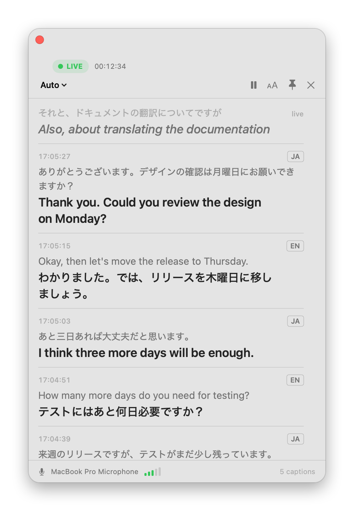

# Kikitori (聞き取り) for Homebrew

**A private meeting recorder and live translator for macOS.** Kikitori
records meetings, transcribes and summarizes them, and translates Japanese ↔
English live. Everything runs on your Mac with Apple's own speech,
translation and Apple Intelligence models: no cloud services, no accounts,
no telemetry.

<p align="center">
  <picture>
    <source media="(prefers-color-scheme: dark)" srcset="images/panel-dark.png">
    
  </picture>
</p>

## Install

```bash
brew install --cask kunalkushwaha-reazon/kikitori/kikitori
```

Kikitori isn't notarized by Apple yet, so macOS blocks it the first time you
open it. Go to **System Settings › Privacy & Security** and click **Open
Anyway**. Then look for the waveform icon in the menu bar.

To update, run `brew upgrade --cask kikitori`. macOS asks for microphone,
system audio and calendar permissions again after each update. That's
expected until releases are signed.

## Requirements

- macOS 26 (Tahoe) or later, on a Mac with Apple silicon.
- Apple's Japanese and English speech models. Kikitori offers to download
  them the first time you use live translation.
- Japanese and English in System Settings › General › Language & Region ›
  Translation Languages.
- For meeting summaries: Apple Intelligence turned on.

## Features

- **Live translation panel.** Docked to the side of the screen, with the
  newest text at the top. Japanese and English are detected sentence by
  sentence.
- **Translate the other side of a call.** Capture Zoom, Teams, Meet (in a
  browser) or any other app's audio.
- **Record meetings**, from your microphone or both sides of a call.
- **Transcripts and summaries** after the meeting, written on your Mac.
- **Calendar reminders** with Start Recording buttons.

Release notes are on the [Releases](https://github.com/kunalkushwaha-reazon/homebrew-kikitori/releases)
page. Kikitori's source code is being prepared for publication under the
Apache License 2.0.

## Uninstall

```bash
brew uninstall --cask kikitori
brew uninstall --zap --cask kikitori   # also removes Kikitori's settings
```

Neither removes your meeting folders (`~/meetings` by default).

## License

[Apache License 2.0](LICENSE)
